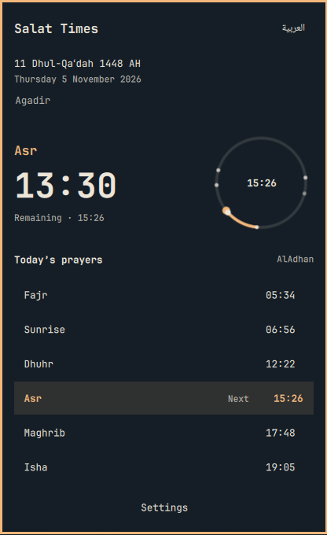

# Salat Times for Omarchy

Prayer times for the Omarchy bar: the next salah, the time remaining, the Hijri date, qibla, and the full day. Habous tables, AlAdhan, and offline calculation stay available when you are online or not.




## Install

Requires Omarchy Quattro with its Quickshell plugin runtime and `curl`. Qt Quick Controls and the Omarchy `qs.Commons` / `qs.Ui` modules are supplied by the desktop. No additional service, installer, root access, or remote build is required.

```sh
omarchy plugin add https://github.com/Abdelhakim-Baalla/omarchy-salat-times.git --enable
```

The widget defaults to the center bar section. To move it beside the clock:

```sh
omarchy bar move abdelhakim.salat --section centerEnd
```

## Daily use

- Left-click the bar widget to open the timetable; Escape closes it.
- Right-click the widget to cycle its label styles.
- Middle-click, the language button, or `A` switches Arabic and English.
- `S` opens settings; Tab moves through settings controls and Escape returns to the timetable.
- `E` edits a location; `M` cycles calculation methods; `B` cycles bar styles.
- The countdown leads a compact next-prayer surface. A small day dial places prayer markers clockwise from midnight and traces the current prayer window.
- Friday Dhuhr reads as Jumu'ah. Rows mark passed, now, and next. In Ramadan, a line gives suhoor or iftar.
- Qibla is the bearing from your coordinates to the Kaaba.

## Settings

Choose a Moroccan Habous city, use your Omarchy weather location, search worldwide with **city, country**, or enter latitude and longitude without a network connection. Selecting an international search result switches away from Habous. Search results identify the region and country; the location only changes when you select a result. All clocks and countdowns use your desktop timezone, including when you explore a location abroad. Change your system timezone when travelling. Calculation methods include Morocco, MWL, Egypt, ISNA, Makkah, Karachi, Tehran, Jafari, Algeria, and Tunisia, with Standard or Hanafi Asr calculation and a minute correction. Reminders support notifications, a dismissible overlay, or silent mode, with optional advance reminders.

**Hijri date:** the Islamic civil calendar replaces the previous incorrect conversion. Use the separate −2 to +2 day adjustment to align with your local moon-sighting authority. This is a calculated date, not an official sighting feed. The same adjustment controls the Ramadan fasting hint. Dates change at civil midnight.

The source shown beside the daily schedule identifies the data actually in use: Habous, AlAdhan, or offline calculation. Sunrise is included as a day marker, not a prayer. Calculated results can differ from a local mosque’s timetable. Tomorrow’s missing online data is calculated locally.

## Network and privacy

Online tables are enabled initially. Turn off **Online prayer tables** in Settings to use local astronomical calculations and stop scheduled table requests. When enabled, requests happen at startup, hourly, at midnight, and after relevant setting changes. Habous is tried first when selected; AlAdhan is the fallback. HTTPS certificate verification, request timeouts, and response-size limits are enabled.

- `www.habous.gov.ma`: selected Moroccan city identifier for official tables.
- `api.aladhan.com`: coordinates, method, madhab, and date for calculated online times.
- `geocoding-api.open-meteo.com`: a city query when using location search or selecting a Habous city while online (to update coordinates for Qibla and fallback calculations). Search remains an explicit online action even when online tables are disabled.

No analytics, account, or API key. The plugin reads the local Omarchy weather location when configured to follow it. Settings are stored in `~/.local/state/omarchy/salat.json`; existing settings are preserved. The plugin runs with the same permissions as the Omarchy shell.

## Remove

```sh
omarchy plugin remove abdelhakim.salat
```

Removal leaves the local settings file so a later installation can reuse it. Delete that file manually if you also want to forget the settings.

## Development

```sh
omarchy plugin validate .
node tests/model.test.cjs
```

QML uses virtual `qs` imports provided by Quickshell. Check runtime loading in the actual shell; standalone `qmllint` needs those imports configured and otherwise reports unresolved types. Desktop animation preferences are honored through Omarchy’s native controls and `Style.duration`.

## License

MIT; see [LICENSE](LICENSE). The offline engine uses astronomical prayer-time formulas in the PrayTimes tradition. The English and Arabic previews are actual desktop captures. The marketplace mosque backdrop is AI-generated with OpenAI ImageGen; its generation prompt is recorded in `artwork/README.md`. No font files are bundled.

## Questions

### Does Salat Times work outside Morocco?

Yes. Search for a city and country, select the matching result, and choose your local calculation method. For example, use ISNA where your community follows ISNA, or MWL where it follows MWL. Standard and Hanafi Asr are available. Habous tables are specific to Morocco. Remote locations are displayed in your desktop timezone.

### Why can the Hijri date differ from my mosque?

Local moon-sighting decisions can differ from a civil calendar. Adjust the Hijri day in Settings to follow your authority. Prayer-time correction and Hijri-day correction are independent.

### Can I use prayer times offline?

Yes. Disable online tables and enter your coordinates in Settings. The local engine calculates the timetable; city-name search requires internet access. At extreme latitudes the engine uses an estimated fallback when sunrise or twilight does not occur. Consult your community’s timetable for these cases.

### How do I open settings from a script?

```sh
omarchy-shell abdelhakim.salat.widget settings
omarchy-shell salat status
```

## Discover and contribute

[Omarchy plugin marketplace](https://plugins.omarchy.org/plugin.html?id=abdelhakim.salat) · [Report a bug](https://github.com/Abdelhakim-Baalla/omarchy-salat-times/issues) · [Changelog](CHANGELOG.md)

Salat Times is an open-source Muslim prayer-time plugin for Omarchy Linux and its Quickshell desktop bar. It includes salah / salat times, adhan reminders, Arabic and English, a Hijri calendar, Qibla direction, and Ramadan suhoor and iftar information.
