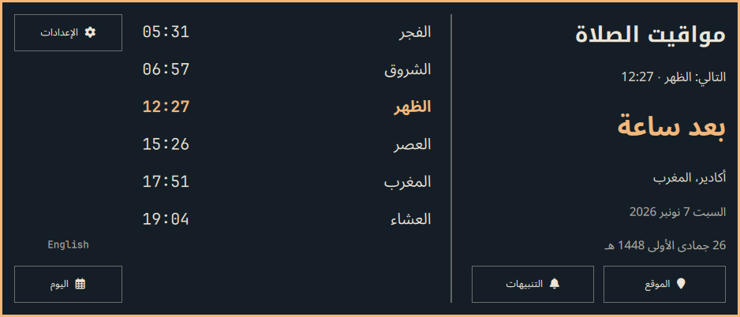
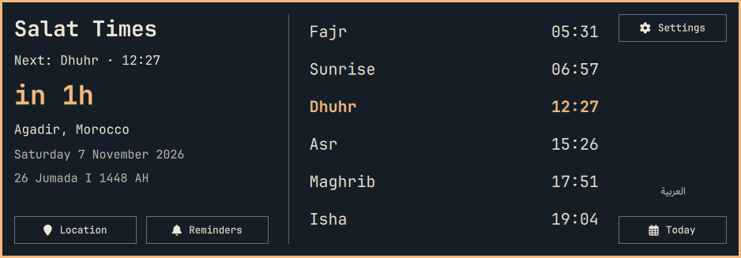

# Salat Times — prayer times for Omarchy


An Arabic-first Muslim prayer-time plugin for the Omarchy Linux bar. See the next salah, its countdown, today's timetable, the Hijri date and Qibla direction. The wide split view puts the next-prayer summary beside today’s timetable. It follows your desktop colors and English font, with dedicated Arabic typography and a mirrored Arabic layout. Arabic is the default; switch to English at any time. An explicit saved English preference is respected.

Choose a location from **249 countries and territories**, use an offline city preset, or enter coordinates. Supports adhan notifications, Ramadan suhoor/iftar hints, Moroccan Habous tables, AlAdhan and offline calculation.

[View in the Omarchy marketplace](https://plugins.omarchy.org/plugin.html?id=abdelhakim.salat) · [Installation](#install) · [Location setup](#location-setup) · [Report an issue](https://github.com/Abdelhakim-Baalla/omarchy-salat-times/issues)

## Screenshots

Actual desktop captures of version 1.6.0. Your colors and English font follow your active Omarchy theme.



<details>
<summary>English view</summary>



</details>

## Install

Requires Omarchy Quattro with its Quickshell plugin runtime and `curl`. Qt Quick Controls and the Omarchy `qs.Commons` / `qs.Ui` modules are supplied by the desktop. No additional service, installer, root access, or remote build is required.

```sh
omarchy plugin add https://github.com/Abdelhakim-Baalla/omarchy-salat-times.git --enable
```

The widget defaults to the center bar section. To move it beside the clock:

```sh
omarchy bar move abdelhakim.salat --section centerEnd
```

## Daily use

- Left-click the bar widget to open the wide panel. Escape closes it.
- The summary shows the next prayer, exact start and readable countdown beside six daily times. After Isha, the summary explicitly says tomorrow; the timetable continues to show today.
- Open **Location**, **Reminders** or **Settings** directly from the panel; **Back to timetable** returns to the day.
- Arabic starts by default. Use the language button or `A` to switch Arabic/English. Middle-clicking the widget also switches languages.
- `E` opens Location; `S` opens prayer settings. Tab navigates controls and Escape returns from settings.
- Arabic bar countdowns use **د** (minutes) and **س** (hours), with stable right-to-left ordering.
- **Today** opens Qibla, the timetable source, Ramadan hints and refresh.
- Right-click or `B` cycles bar labels. `M` cycles calculation methods.
- Friday Dhuhr reads as Jumu'ah. Sunrise is a day marker. Ramadan adds a suhoor or iftar hint.

## Location setup

1. Open **Location**. The current saved location appears above the controls.
2. Optionally choose a **Country filter**. This narrows the available cities; it does not move your saved location.
3. Choose an **Offline city preset**, or use **Search any city** and select a matching result. City search requires internet access. Results identify the region and country.

The 23 offline presets include Riyadh, Makkah, Medina, Cairo, Alexandria, New York, Chicago, Los Angeles, London, Toronto, Dubai and Jakarta. All 249 countries/territories are searchable filters; the preset list is deliberately smaller. For a place outside the presets, search online or use coordinates.

**More location options** lets you follow your Omarchy weather location, choose a Moroccan Habous city, or enter latitude and longitude without internet. Selecting an international city switches away from Habous.

All times use your **desktop timezone**, even when viewing another country. Change your system timezone when travelling. Qibla is calculated from the selected coordinates to the Kaaba.

## Prayer settings and calendar

**Settings** contains online/offline tables, calculation method, Asr convention, minute correction and Hijri-day adjustment.

Country-based method suggestions use Umm Al-Qura for Saudi Arabia, the Egyptian General Authority for Egypt, and ISNA for the USA/Canada. These are starting points; choose the method your local mosque follows. A manual method selection disables automatic suggestions. Methods also include Morocco, MWL, Karachi, Tehran, Jafari, Algeria, Tunisia, Gulf, Kuwait, Qatar, Singapore, France, Turkey, Russia, Dubai, Malaysia and Indonesia. Standard/Shafi and Hanafi Asr are available.

**Hijri date:** uses the Islamic civil calendar with an independent −2 to +2 day adjustment for local moon-sighting decisions. It is a calculated date, not an official sighting feed. The adjustment also controls the Ramadan hint. Dates change at civil midnight.

**Today** identifies the timetable source—Habous, AlAdhan or offline calculation—and lets you refresh when online tables are enabled. When tomorrow's online data is unavailable, tomorrow is calculated locally. Calculated times can differ from a local mosque's timetable.

## Reminders

Open **Reminders** to choose notifications, a dismissible overlay or silent mode. Enable alerts at prayer time, before prayer, or both, and adjust the advance interval. These are desktop alerts; the plugin does not include an audio adhan recording.

## Network and privacy

Online tables are enabled initially. Turn off **Online prayer tables** in Settings to use local astronomical calculations and stop scheduled table requests. When enabled, requests happen at startup, hourly, at midnight, and after relevant setting changes. Habous is tried first when selected; AlAdhan is the fallback. HTTPS certificate verification, request timeouts, and response-size limits are enabled.

- `www.habous.gov.ma`: selected Moroccan city identifier for official tables.
- `api.aladhan.com`: coordinates, method, madhab, and date for calculated online times.
- `geocoding-api.open-meteo.com`: a city query when using location search or selecting a Habous city while online (to update coordinates for Qibla and fallback calculations). Search remains an explicit online action even when online tables are disabled.

No analytics, account, or API key. The plugin reads the local Omarchy weather location when configured to follow it. Settings are stored in `~/.local/state/omarchy/salat.json`; existing settings are preserved. The plugin runs with the same permissions as the Omarchy shell.

## Remove

```sh
omarchy plugin remove abdelhakim.salat
```

Removal leaves the local settings file so a later installation can reuse it. Delete that file manually if you also want to forget the settings.

## Development

```sh
omarchy plugin validate .
node tests/model.test.cjs
# Optional native interaction regression test (requires Quickshell):
python3 tests/search.test.py
```

QML uses virtual `qs` imports provided by Quickshell. Check runtime loading in the actual shell; standalone `qmllint` needs those imports configured and otherwise reports unresolved types. Desktop animation preferences are honored through Omarchy’s native controls and `Style.duration`.

## License

MIT; see [LICENSE](LICENSE). The offline engine uses astronomical prayer-time formulas in the PrayTimes tradition. Arabic body text uses Noto Sans Arabic, with Noto Kufi Arabic for headings. English and numeric text use your current Omarchy font. The Arabic families are part of the Noto font collection; Qt falls back to an installed font when unavailable. The English and Arabic previews are actual desktop captures. The blue-hour mosque cover is AI-generated with OpenAI ImageGen; its exact generation prompt and the design alternatives are recorded in [artwork/README.md](artwork/README.md). No font files are bundled.

## Questions

### Does Salat Times work outside Morocco?

Yes. Search for a city and country, select the matching result, and choose your local calculation method. For example, use ISNA where your community follows ISNA, or MWL where it follows MWL. Standard and Hanafi Asr are available. Habous tables are specific to Morocco. Remote locations are displayed in your desktop timezone.

### Why can the Hijri date differ from my mosque?

Local moon-sighting decisions can differ from a civil calendar. Adjust the Hijri day in Settings to follow your authority. Prayer-time correction and Hijri-day correction are independent.

### Can I use prayer times offline?

Yes. Disable online tables in Settings, then choose an offline city preset or enter coordinates under Location → More location options. The local engine calculates the timetable; city-name search requires internet access. At extreme latitudes the engine uses an estimated fallback when sunrise or twilight does not occur. Consult your community’s timetable for these cases.

### How do I open settings from a script?

```sh
omarchy-shell abdelhakim.salat.widget settings
omarchy-shell salat status
omarchy-shell abdelhakim.salat.widget page location
omarchy-shell abdelhakim.salat.widget page reminders
omarchy-shell abdelhakim.salat.widget page day
omarchy-shell salat language ar
# Open Saudi quick-city selection:
omarchy-shell abdelhakim.salat.widget country SA
```

## Discover and contribute

[Omarchy plugin marketplace](https://plugins.omarchy.org/plugin.html?id=abdelhakim.salat) · [Report a bug](https://github.com/Abdelhakim-Baalla/omarchy-salat-times/issues) · [Changelog](CHANGELOG.md)

Salat Times is an open-source Muslim prayer-time plugin for Omarchy Linux and its Quickshell desktop bar. It includes salah / salat times, adhan reminders, Arabic and English, a Hijri calendar, Qibla direction, and Ramadan suhoor and iftar information.

## Data sources

Country codes follow ISO 3166-1 (`iso-codes`); English and Arabic country names use ICU display names. Built-in city coordinates were retrieved from GeoNames through the [Open-Meteo geocoding API](https://open-meteo.com/en/docs/geocoding-api) on 6 November 2026. Calculation method identifiers and angles follow [AlAdhan's method list](https://api.aladhan.com/v1/methods). Search availability depends on the geocoder's coverage.
