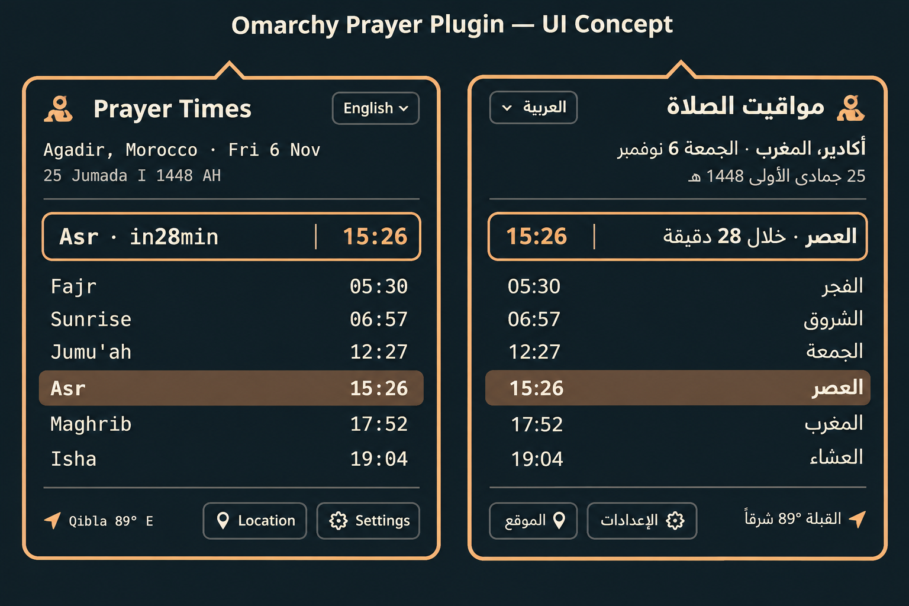
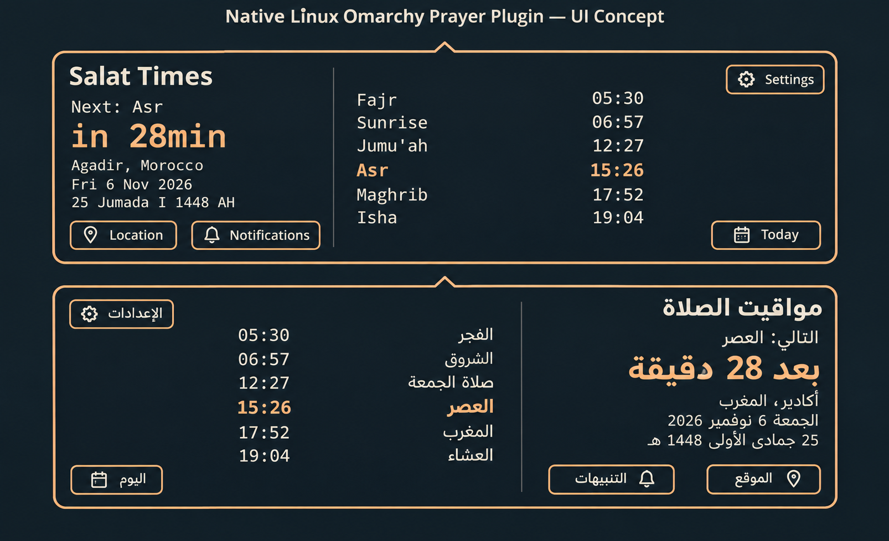
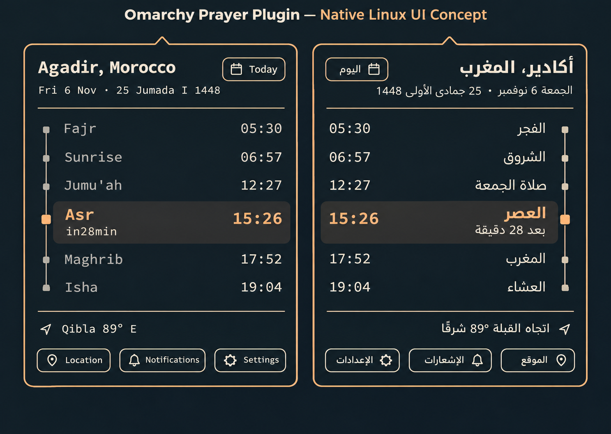
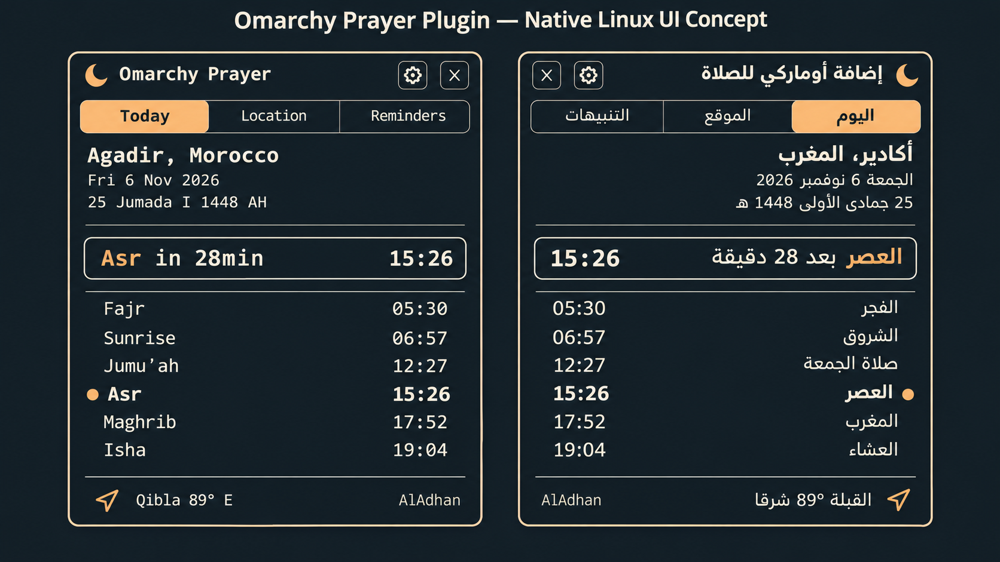

# Salat Times artwork

The selected 1.5 cover is **Blue-hour mosque skyline**: a cobalt sky, coral horizon, silhouetted mosque and large ivory title. The user approved thumbnail 3 on 6 November 2026. `../marketplace.png` and `../preview.png` contain this cover; the marketplace reads the root preview automatically. The architecture is generated, not a photograph of a named building.

The selected UI concept is **B — Wide split view**. It guides composition; the working plugin uses live Omarchy theme tokens and real prayer data. Generated concepts below contain illustrative data and are not screenshots. Actual desktop captures are in [screenshots](screenshots/), with capture provenance embedded.

All seven proposals were generated with the built-in OpenAI ImageGen tool. Exact prompts, source image filenames and selection status are recorded in adjacent `.prompt.json` files and embedded in each PNG. No stock photography or bundled font files are used.

## Interface concepts

| A · Compact timetable | B · Wide split view — selected |
| --- | --- |
|  |  |

| C · Prayer timeline | D · Organized tabs |
| --- | --- |
|  |  |

## Thumbnail alternatives

### 1 · Night architecture

### 2 · Ivory architectural poster

### 3 · Blue-hour skyline — selected

## Earlier artwork

Version 1.4 used the Noor mihrab concept. Its historical prompt remains in [noor-prompt.txt](noor-prompt.txt). The current interface follows the system palette.

## Plugin icon

`../icon.svg` is a repository-authored mosque-arch mark in ivory and peach on cobalt, with a matching `../icon.png` export. It appears in the README. The current marketplace title component renders initials rather than an icon file; adding these assets alone does not replace the “ST” tile. Custom listing icons require marketplace support.
